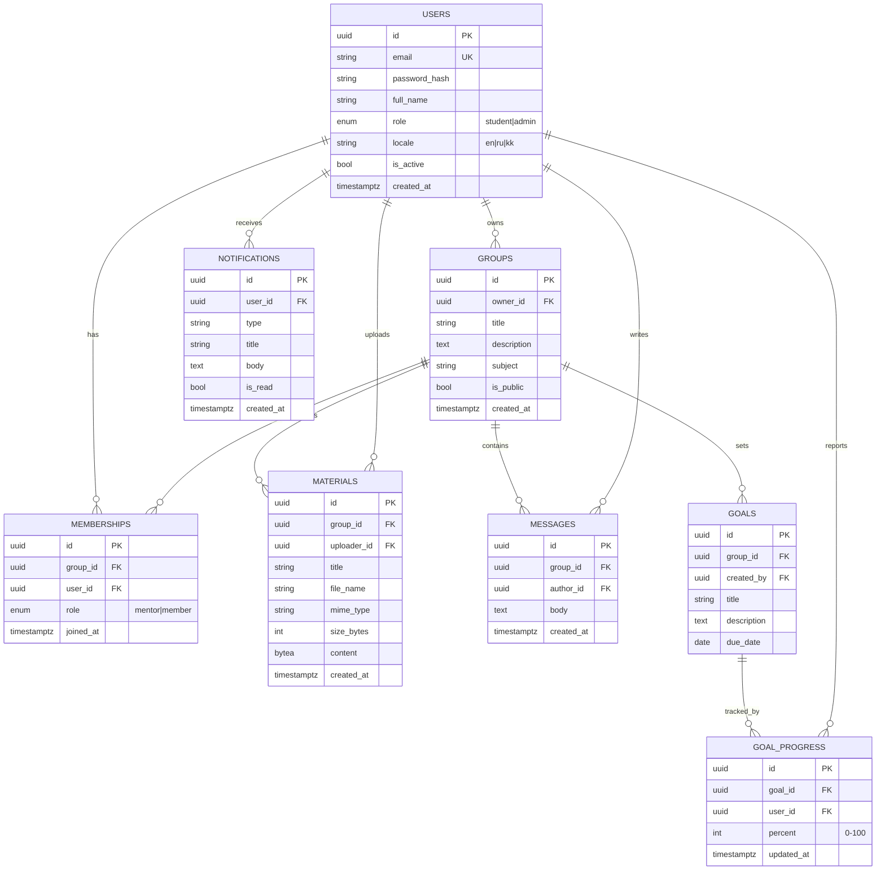

# Tandem — study groups that actually finish things

Single source of truth for every agent. Course: Basics of Information Systems. Exam: project presentation + live demo (see `docs/EXAM.md`).

## 1. Topic
A web platform where students form study groups, share materials, chat, set shared goals and track each member's progress.

## 2. Aim
Give students one place to study together: find or create a group, exchange files and messages, and see who is on track toward shared goals.

## 3. Objectives
1. Secure registration, login and profile management (JWT access + refresh).
2. Study groups: create, join, leave, roles (mentor / member).
3. Group collaboration: chat, material upload/download (files stored in Postgres).
4. Goals and per-member progress tracking with a progress dashboard.
5. In-app notifications (new message, new material, new goal, progress milestones).
6. Global search over groups, materials and users.
7. Multilanguage UI: English, Russian, Kazakh.
8. Admin panel: CRUD for users/groups/materials, role-based access.

## 4. Competitive analysis
| | Tandem | Google Classroom | Discord | Notion |
|---|---|---|---|---|
| Built for peer study groups | Yes | No (teacher-led) | No (generic chat) | No (generic workspace) |
| Group chat | Yes | Stream only | Yes | Comments only |
| Shared goals + per-member progress | Yes | Assignments, not goals | No | Manual databases |
| File sharing | Yes | Yes (Drive) | Yes (size-limited) | Yes |
| Kazakh / Russian / English UI | Yes | Partial | Partial | Partial |
| Setup effort | Seconds | Needs a teacher/class | Servers + bots | Heavy templates |
Gap: nothing combines peer-led groups, chat, materials and visible progress in one light tool.

## 5. SWOT
- **Strengths:** focused niche, progress visibility per member, trilingual UI, simple onboarding, single Postgres storage (easy deploy).
- **Weaknesses:** new product with no user base, polling instead of real-time sockets, files capped at 10 MB, no mobile app.
- **Opportunities:** universities in KZ/CIS lacking local-language tools, LMS integrations, AI study assistant, gamification.
- **Threats:** established tools adding similar features, low switching motivation, moderation load for public groups.

## 6. Use cases
Actors: **Guest**, **Student** (registered user), **Mentor** (member with mentor role in a group), **Admin**.
Use cases (Guest → 2, Student → rest, Mentor extends Student, Admin separate):
1. Register / Log in (Guest)
2. Browse public groups (Guest)
3. Edit profile and language (Student)
4. Create group (Student → becomes Mentor of it)
5. Join / leave group (Student)
6. Chat in group (Student)
7. Upload / download material (Student)
8. Track my progress on goals (Student)
9. Search groups, materials, users (Student)
10. Read notifications (Student)
11. Create / edit goals, remove members, moderate materials in own group (Mentor)
12. Manage users, groups, materials, roles (Admin)

## 7. Data model (ER)

Constraints: `(group_id,user_id)` unique in memberships, `(goal_id,user_id)` unique in goal_progress. Mentor-only actions are enforced by membership role; platform-wide admin by `users.role`.

## 8. Required demo features mapped to the app
| Exam item | Where |
|---|---|
| 5+ functionalities | auth, profile, groups, chat, materials upload, goals/progress, notifications, search |
| Multilanguage | en / ru / kk, switcher in header, saved to profile, all UI strings translated |
| Search | `/search?q=` over groups + materials + users, grouped results |
| Admin panel | `/admin`: tables with create/edit/delete for users, groups, materials; admin-only route guard |

## 9. Tech and layout
- `server/` FastAPI, fully async (SQLAlchemy 2 async + asyncpg), Alembic, Pydantic v2. Env: `POSTGRES_URL`, see `.env.example`.
- `client/` React + TypeScript + Vite, Feature-Sliced Design, own UI kit, i18n via react-i18next. Types generated from `server/openapi.json`.
- `render.yaml` Render Blueprint: web service (server) + static site (client).
- Brand: name **Tandem**, own SVG logo and design tokens (no UI library).
